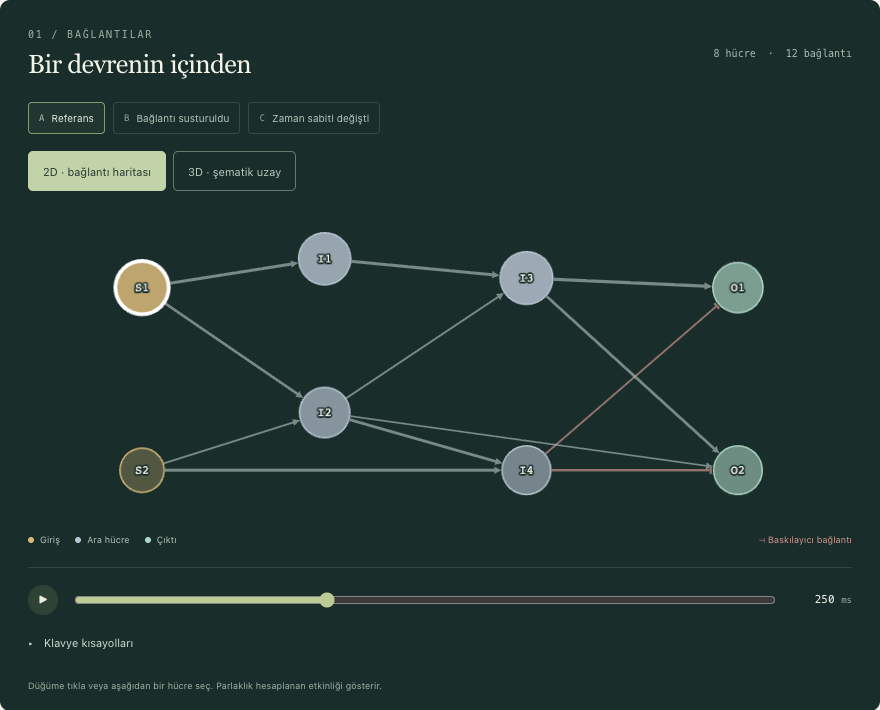
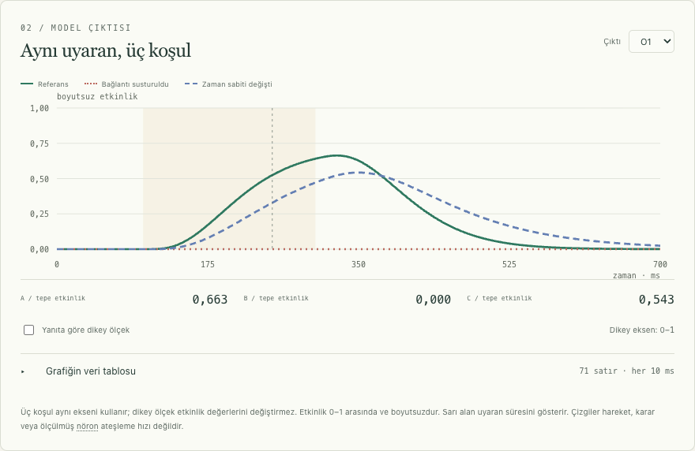
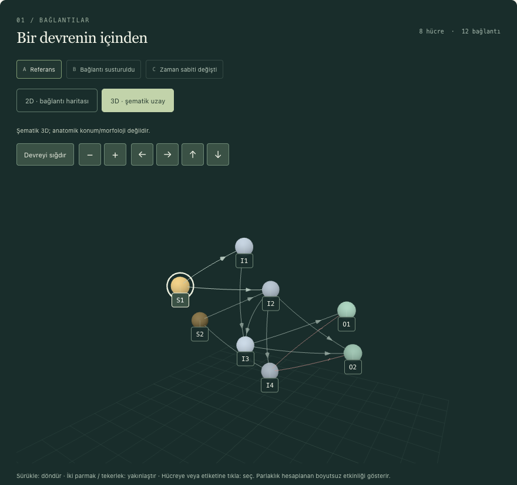
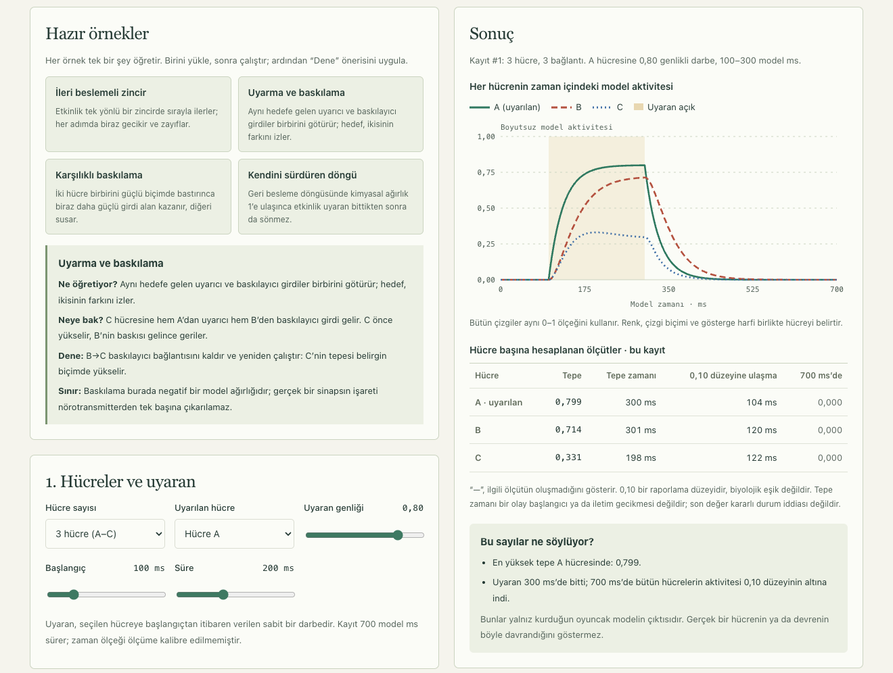
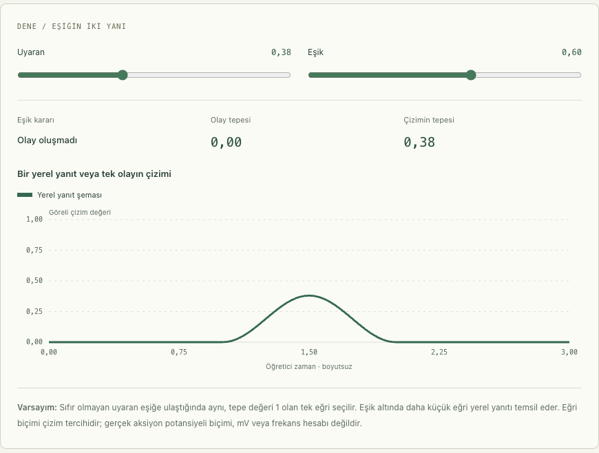
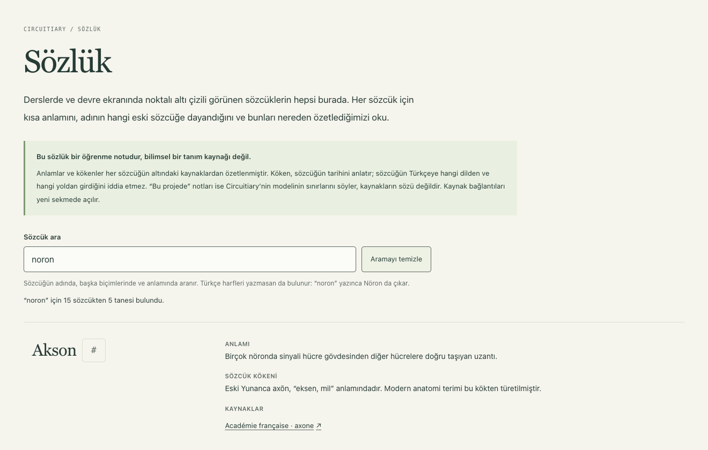
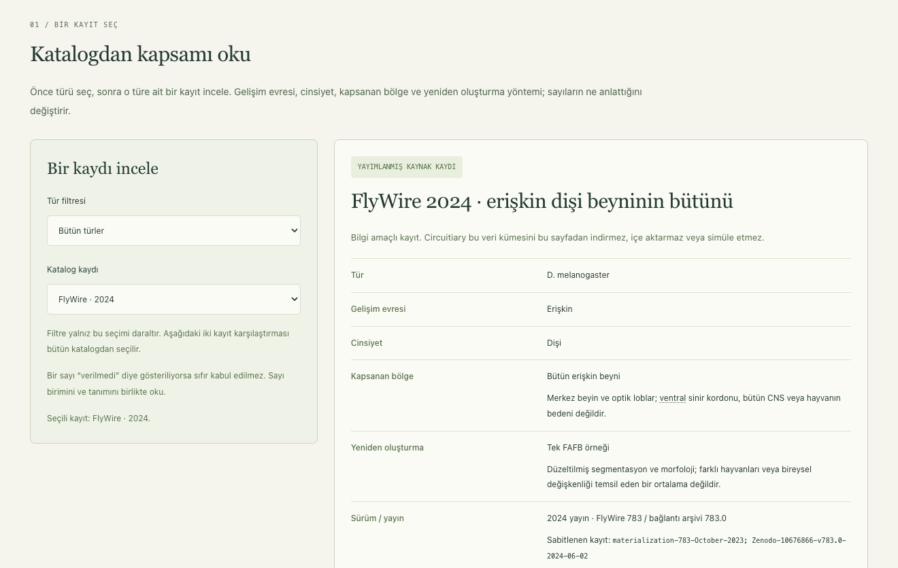

# Circuitiary

**Küçük sinir devrelerini kurarak, deneyerek öğrenmek için etkileşimli bir Türkçe deney defteri.** Parametreli bir öğretim modelidir: ölçüm değildir, davranış simülasyonu değildir ve biyolojik beyin emülasyonu değildir.

[](https://github.com/mehmet-bozkurt/Circuitiary/actions/workflows/ci.yml)
[](LICENSE)

## Canlı demo

**[mehmet-bozkurt.github.io/Circuitiary](https://mehmet-bozkurt.github.io/Circuitiary/)**: kurulum gerektirmeden tarayıcıda deneyin. Site GitHub Pages ile yayımlanır; depo özel olduğu sürece bağlantı açılmaz. Demo sekiz hücreli kurgusal devreyi ve verisiz sayfaları kullanır; yerel gerçek veri çevrimiçi demoda yoktur, “yerel veri gerekir” işaretli bölümler orada çalışmaz. [English summary](#english-summary) aşağıdadır.

<table>
<tr>
<td width="50%"><br><sub>2D bağlantı haritası: sekiz hücreli kurgusal devre, S1 uyarılıyor</sub></td>
<td width="50%"><br><sub>Aynı uyaran, üç koşul: referans, susturulan bağlantı, değişen zaman sabiti</sub></td>
</tr>
<tr>
<td width="50%"><br><sub>3D şematik uzay (konumlar anatomik konum değildir)</sub></td>
<td width="50%"><br><sub>Devre kur: hazır örneği çalıştır, her hücrenin eğrisini ve tablosunu oku</sub></td>
</tr>
</table>

<details>
<summary>Daha fazla ekran görüntüsü</summary>

<table>
<tr>
<td width="33%"><br><sub>Nörondan devreye: eşiğin iki yanı</sub></td>
<td width="33%"><br><sub>Sözlük: Türkçe harfe duyarlı arama</sub></td>
<td width="33%"><br><sub>Türler atlası: yayımlanmış bir kaydın kapsamı</sub></td>
</tr>
</table>

</details>

Ekran görüntüleri yalnız sekiz hücreli kurgusal devreden ve yerel veri gerektirmeyen sayfalardan alınmıştır.

## Neler var

Her satır bir sayfayı ya da özelliği tanıtır; ayrıntı, sınırlar ve doğrulama kaydı bağlantılı belgededir. “Yerel veri gerekir” işaretli parçalar, sizin içe aktardığınız C. elegans altgrafı olmadan çalışmaz ([Veri ve lisans](#veri-ve-lisans)).

- **Deney** (`/`): sekiz hücreli kurgusal devrede bir uyaranın izini sürün. Aynı uyaranı üç koşulda (referans, bağlantı susturma, zaman sabiti değişimi) yan yana karşılaştırın; devreyi 2D bağlantı haritasında ya da 3D şematik uzayda görün. Yerel veri varsa ikinci mod, 30 nöronluk gerçek altgraftır. [Bilimsel kapsam](docs/scientific-scope.md), [3D görünüm](docs/3d-verification.md).
- **Nörondan devreye** (`/ogren/norondan-devreye`): nöronun parçalarından elektriksel sinyale, sinapslara ve üç hücreli devreye altı bölümlük ders; etkileşimli örnekler ve sekiz soru. [Belge](docs/neuron-lesson.md).
- **Rehberli deneyler** (`/ogren/rehberli-deneyler`): tahmin et, çalıştır, farkı oku; üç kontrollü karşılaştırma. [Belge](docs/guided-experiments.md).
- **Devreyi okumak** (`/ogren/devreyi-okumak`, yerel veri gerekir): bağlantı kayıtlarını, yolları ve döngüleri anatomi olarak okumak; bunun sinyal geçişi kanıtı olmadığını görmek. [Belge](docs/circuit-reading.md).
- **Gerçek veri ve varsayımlar** (`/ogren/gercek-veri-ve-varsayimlar`, yerel veri gerekir): kaynaktaki kayıt ile seçilmiş dinamik varsayımları ayırın; **eşik taraması** kimyasal çarpanı tarayıp 1 eşiğinin modelin özelliği olduğunu gösterir. [Varsayımlar](docs/real-data-assumptions.md), [eşik taraması](docs/threshold-sweep.md).
- **Türler atlası** (`/ogren/turler-atlasi`): C. elegans ve Drosophila için yayımlanmış kayıtların kapsam, sayı birimi, sürüm ve erişim farkları; statik katalogdur, veri yüklemez. [Belge](docs/species-atlas.md).
- **Devre kur** (`/ogren/devre-kur`): 2–6 hücreli oyuncak bir devre kurun, bir hücreyi uyarın, her hücrenin eğrisini ve tablosunu görün; dört hazır örnek. [Belge](docs/circuit-builder.md).
- **Sözlük ve sözcük kartları** (`/ogren/sozluk`): metindeki noktalı altı çizili terimlerin anlamı, kökeni ve kaynakları; Türkçe harfe duyarlı arama. [Sözlük](docs/glossary-page.md), [kartlar](docs/term-hints.md).
- **Paylaş ve dışa aktar**: deney ayarları bağlantı olarak paylaşılır; grafik CSV, okunan hücre JSON olarak indirilir; hepsi tarayıcıda üretilir. [Belge](docs/share-and-export.md).
- **Grafik veri tablosu ve klavye kısayolları**: grafikle aynı değerler gerçek bir tabloda; Boşluk, ←/→ ve Home ile oynatma. [Belge](docs/chart-table-and-shortcuts.md).
- **Yazdırma**: her sayfa A4'e açık renkli ve düğmesiz çıkar; alt bilgide “eğitim amaçlı model; ölçüm değildir”. [Belge](docs/printing.md).
- **Çevrimdışı kullanım**: üretim derlemesi bir kez açıldıktan sonra sayfalar ve sekiz hücreli deney ağsız çalışır. [Belge](docs/offline.md).
- **Tema ve erişilebilirlik**: Sistem, Açık ve Karanlık tema; iki temada WCAG AA metin kontrastı otomatik test edilir.

## Hızlı başlangıç

```sh
git clone https://github.com/mehmet-bozkurt/Circuitiary.git && cd Circuitiary
npm ci --ignore-scripts
npm run dev
```

Üçüncü adım Vite'in yazdığı yerel adresi açar (varsayılan `http://127.0.0.1:5173/`). Node 22.12+, 24 veya 26+ gerekir; hesap, ücretli API veya GPU gerekmez, simülasyon tarayıcıda çalışır.

Sekiz hücreli örnek, dersler, devre kurucu, sözlük ve atlas kurulumdan hemen sonra çalışır. **Gerçek veri modu** (30 nöronluk C. elegans altgrafı) yerel veri ister: veri bu depoda yoktur, kaynaktan kendiniz indirip `scripts/import_cook2019.py` ile içe aktarırsınız ([adımlar](#gerçek-veri-ve-tekrar-üretim)). Veri yoksa uygulama bunu açıklayan bir mesaj gösterir ve sekiz hücreli mod çalışmaya devam eder.

## Bilimsel kapsam

Circuitiary, bir devrenin bağlantı yapısı ile onun üstüne kurulan dinamik varsayımlar arasındaki farkı öğretmek için yapılmış **parametreli bir öğretim modelidir**. Etkinlik 0–1 arasında, boyutsuz ve sürekli bir değişkendir; zar potansiyeli, ateşleme hızı ya da kalsiyum sinyali olarak kalibre edilmemiştir. Zaman sabitleri ve milisaniye ekseni modelin seçilmiş ölçeğidir. Bağlantı işaretleri ve ağırlıkları deney için seçilmiş varsayımlardır. Sonuçlar **ölçüm değildir**, bir hayvanın davranışını göstermez ve **beyin emülasyonu** iddiası taşımaz. Anatomik graf (kaynağın bildirdiği hücreler ve bağlantılar) ile dinamik varsayımlar uygulamada her yerde ayrı tutulur. Ayrıntı: [docs/scientific-scope.md](docs/scientific-scope.md).

## Veri ve lisans

- **Kod:** MIT lisansı ([LICENSE](LICENSE)). Kullanılan kitaplıkların (Vue, Cytoscape.js, three.js: MIT) lisansları, veri kaynaklarının durumu ve atıflar: [THIRD_PARTY_NOTICES.md](THIRD_PARTY_NOTICES.md).
- **Bu depoda veri yoktur.** Gerçek veri modu, Cook ve ark. (Nature 2019) bağlantı tablosundan yapılmış 30 nöronluk bir altgrafa dayanır; kaynak [WormWiring](https://wormwiring.org/pages/adjacency.html) ve [makale](https://doi.org/10.1038/s41586-019-1352-7). Bu dosyaların yeniden dağıtım lisansı **doğrulanmadığı** için `data/raw/` ve `data/local/` git'in dışında tutulur, yayımlanan demoya konmaz.
- Veriyi içe aktarırsanız kaynağı anın; gerçek veri içeren bir çıktıyı halka açık paylaşmadan önce lisans ve yazar iznini doğrulayın. Ayrıntı: [Yerel veri / paylaşım sınırı](#yerel-veri--paylaşım-sınırı).

## Katkı

Her büyüklükte katkı değerlidir: yazım düzeltmesi, kaynaklı bir sözlük maddesi, bir ders cümlesine itiraz, yeni bir önayar.

- [CONTRIBUTING.md](CONTRIBUTING.md): kurulum, kurallar, ilk katkı fikirleri. [CODE_OF_CONDUCT.md](CODE_OF_CONDUCT.md) davranış kurallarıdır.
- [SECURITY.md](SECURITY.md): güvenlik açığını herkese açık issue olarak değil, özel bildirimle iletin.
- [Issue şablonları](.github/ISSUE_TEMPLATE): hata, özellik önerisi ve bilimsel düzeltme için ayrı formlar. Bilimsel bir cümleye itiraz etmek de değerli bir katkıdır.

## Atıf

Öğretim ya da araştırma materyalinde kullanırsanız [CITATION.cff](CITATION.cff) dosyasına bakın; GitHub'ın “Cite this repository” düğmesi de bu dosyayı kullanır. Düz metin: Bozkurt, M. (2026). *Circuitiary* (sürüm 0.1.0) [yazılım]. https://github.com/mehmet-bozkurt/Circuitiary. Henüz DOI yoktur.

## English summary

**Circuitiary** is an interactive, Turkish-language teaching notebook about small neuron circuits. You trace a stimulus through an eight-cell illustrative circuit, compare the same stimulus under three conditions (reference, a silenced connection, a changed time constant) in 2D and 3D, follow guided lessons, look words up in a glossary, compare published connectome records in a species atlas, and assemble your own 2–6-cell toy circuits.

**What it is not.** It is a parameterised teaching model, not a measurement, not a behaviour simulation and not a biological brain emulation. Activity is dimensionless (0–1) and the time units are uncalibrated teaching choices; anatomy (where a source is cited) is kept apart from the dynamics assumptions. See [docs/scientific-scope.md](docs/scientific-scope.md) (Turkish).

**Run it.** Node 22.12+, 24 or 26+. Everything runs in the browser; no account, paid API or GPU is needed.

```sh
npm ci --ignore-scripts
npm run dev        # open the address Vite prints (default http://127.0.0.1:5173/)
```

**Real-data mode (optional).** A second mode uses a 30-neuron subgraph of the *C. elegans* connectome built from Cook et al. 2019 (via WormWiring). The data files are not in this repository because their redistribution licence has not been verified; you download and import them yourself with `scripts/import_cook2019.py`. Without them the app explains this and the eight-cell mode keeps working. The online demo has no real-data mode.

**Status.** Version 0.1.0. Type check, unit tests, production build and Python importer tests run in CI; the browser tests run locally with the system Chrome. Test counts are in the section “Güncel doğrulama durumu” (Turkish).

**Licence and contributing.** Code: MIT ([LICENSE](LICENSE)); no data is included. Cite via [CITATION.cff](CITATION.cff). Contributions and security reports: [CONTRIBUTING.md](CONTRIBUTING.md) and [SECURITY.md](SECURITY.md), each with an English summary.

---

## Ayrıntılı belge

Bundan sonrası projenin Türkçe ayrıntılı belgesidir: [Gerçek veri ve tekrar üretim](#gerçek-veri-ve-tekrar-üretim) · [Dinamik ve sınır koşulu](#dinamik-ve-sınır-koşulu) · [Kontroller](#kontroller) · [Güncel doğrulama durumu](#güncel-doğrulama-durumu) · [Yerel veri / paylaşım sınırı](#yerel-veri--paylaşım-sınırı) · [Ek özellikler](#ek-özellikler) · [Dosyalar](#dosyalar). Her aşamanın kapsamı ve kaynakları `docs/` klasöründedir.

### Çalıştırma

Proje klasöründe:

```sh
npm ci --ignore-scripts
npm run dev
```

Adres, Vite'in yazdığı yerel adrestir (varsayılan `http://127.0.0.1:5173/`; başka bir port için `npm run dev -- --port 5176`). Gerçek veri düğmesi yalnız yerel veri içe aktarıldıysa ikinci deneye geçirir (bkz. [Gerçek veri ve tekrar üretim](#gerçek-veri-ve-tekrar-üretim)); veri yoksa uygulama açıklayıcı bir mesaj gösterir ve sekiz hücreli mod çalışır. Vite yalnız loopback adresinde dinler; hesap, ücretli API veya GPU gerekmez. Simülasyon tarayıcıda çalışır. Etkinlik oynatıcısı önceden hesaplanan sonuçları gösterir.

Temiz Node kurulumu için Node 22.12+, 24 veya 26+ (Vitest 23 ve 25'i desteklemez; aralık `package.json` içindeki `engines` alanındadır) ve `npm ci --ignore-scripts` kullanılır. Bağımlılıklar `package-lock.json` ile sabittir.

### Görünüm teması

Üst menüdeki **Tema** alanından **Sistem**, **Açık** veya **Karanlık** seçilebilir. İlk açılış sistem tercihini izler; seçim bu tarayıcıda hatırlanır ve açık sekmeler arasında eşleşir. Sistem seçiliyken işletim sisteminin tema değişiklikleri anında uygulanır. Tarayıcı depolaması kapalıysa seçim mevcut sayfa oturumunda çalışır.

Tema bütün öğrenme sayfaları, kontroller, tablolar ve etkinlik grafikleri için geçerlidir. 2D/3D devre tuvalleri kendi koyu çizim paletini kullanır. Tema değişimi deney ayarlarını veya hesaplanan sonuçları değiştirmez.

Tema kontrolleri: `npx playwright test tests/theme.spec.ts`.

### Sözcük anlamı ve kökeni

Deney ve öğrenme metinlerindeki noktalı altı çizili terimlerin üzerine gelerek veya klavyeyle odaklanarak **anlamı, sözcük kökeni ve kaynakları** görülebilir. Tıklama/dokunma kartı açık tutar; Escape, kapatma düğmesi veya dışarı tıklama kapatır. Hermafrodit, nöron, dendrit, akson, sinaps, konnektom ve ablasyon gibi 15 madde bulunur. Açıklamalar açık/karanlık temaya uyar ve çevrimdışı okunabilir; kaynak bağlantıları yeni sekmede açılır. [Kapsam ve kaynak notları](docs/term-hints.md).

### İlk iki deney

1. Sekiz hücreli modda S1 uyarımını O1'den okuyun. `I3 → O1` susturulunca O1 sıfır kalır; `I4 → O1` baskılayıcı bağlantısını susturmak ise O1 yanıtını artırır. Bunlar elle tanımlanmış örnek bağlantılardır.
2. Gerçek veri modunda AVER varsayılan uyaran hedefi, AVAR okunan hücredir. Bunlar deney rolleridir; duyusal/motor sınıflandırma değildir. SI4 hücre sınıfı inspector içinde ayrıca gösterilir.
3. A referans, B tek bağlantının model etkisinin sıfırlanması, C seçilen hücrenin zaman sabitinin değiştirilmesidir. Gap çiftini susturmak iki yönü birlikte kaldırır. Hücreler devrede kalır; bağlantı müdahalesi hücre ablasyonu değildir.
4. Uyaranı sıfır yapın: sıfır başlangıçta üç koşul da sıfır kalmalıdır. Sıfırlama aynı varsayılan deneyi geri getirir. Mod değişimi seçimleri ilgili devreye göre yeniler.
5. Gerçek modda kimyasal/gap katsayılarını değiştirin. Ham anatomi korunur; sonuçların dinamik varsayımlara ne kadar bağlı olduğunu görün. Bu kaynak gerçek kimyasal işaretleri vermez; pozitif işaret deney için açıkça seçilmiştir.
6. Zaman adımını 2 ms ile 0,0625 ms arasında karşılaştırın. Güçlü bağlantılar ve küçük τ, daha ince adım gerektirebilir; belirgin farkta arayüz uyarır. `dt/2` farkı sayısal tutarlılık kontrolüdür; biyolojik doğrulama değildir.

Grafikte seçili hücrenin bağlantılarına odaklanma **yalnız görsel filtredir**; tüm altgraf simüle edilir. Gerçek modda küçük yanıtlar için dikey eksen otomatik yakınlaşır; üç koşul aynı ve açıkça etiketlenen ekseni kullanır. Bu seçenek verileri değiştirmez; istenirse 0–1 eksenine dönülür. Izgara bir okuma düzenidir, anatomik konum değildir. Tüm 30 hücre, klavyeyle kullanılabilen hücre düğmelerinde de bulunur. Kimyasal yönler ok, gap çiftleri yönsüz kesikli çizgiyle gösterilir.

### Gerçek veri ve tekrar üretim

Resmi kaynak [WormWiring](https://wormwiring.org/pages/adjacency.html), makale [Cook ve ark., Nature 2019](https://doi.org/10.1038/s41586-019-1352-7). Bu depoda veri yoktur: düzeltilmiş SI5 ve aynı çalışmanın SI4 listesini kaynaktan indirip `data/raw/` altına koyarsınız, türetilmiş altgraf `data/local/` altına yazılır; ikisi de git'in dışındadır (bkz. [Yerel veri / paylaşım sınırı](#yerel-veri--paylaşım-sınırı)). Sürüm, URL, indirme zamanı, dosya özeti, hücre koordinatları, seçim sırası ve dışarıda kalan bağlantılar JSON'da korunur.

Ham ağırlık **seri EM kesiti ağırlığıdır**; sinaps sayısı, elektriksel iletkenlik veya ölçülmüş dinamik güç değildir. Kimyasal satır kaynak, sütun hedeftir. Matris kare değildir; ithalat bunu bilerek denetler. CANL/CANR kaynak satırı eksikliği raporlanır; beklenmedik eksiklikler reddedilir. Simetrik gap tablosundaki diagonal kayıtlar raporda korunur, dinamik çift olarak yorumlanmaz.

Python 3.10 veya üstü gerekir (3.9'un desteği sona erdi; testler 3.11 ile koşuldu). Yerel Python ortamında yalnız Excel okuyucu gerekir:

```sh
python3 -m venv .venv
.venv/bin/python -m pip install -r requirements-importer.txt
.venv/bin/python scripts/import_cook2019.py \
  --si5 data/raw/cook2019-si5-corrected-july2020.xlsx \
  --si4 data/raw/cook2019-si4-cell-lists.xlsx \
  --si5-downloaded-at 2026-10-03T02:46:04.246507Z \
  --si4-downloaded-at 2026-10-03T02:51:05.053918Z \
  --output data/local/cook-subset.json \
  --acquisition-output data/local/acquisition.json
```

Yukarıdaki zamanlar projenin geliştirildiği makinedeki edinim kaydıdır; kendi indirmenizde kendi gerçek UTC zamanlarınızı verin. İthalat ağ kullanmaz ve beklenen SHA-256 özetlerini denetler. Kaynak dosyalar değiştirilmez. Veri seçimi: AVAR/AVER, bir komşuluk adımı, kimyasal toplam azalan/gap toplam azalan/ad artan, ilk 28 aday; seçilen hücreler arasındaki tüm kimyasal ve tekil gap bağlantıları.

Kaynak edinimi ve bütünlük ayrıntıları [veri raporunda](docs/real-data-next-step.md) yer alır.

### Dinamik ve sınır koşulu

```text
tau_i * dx_i/dt = -x_i + clip(sum_j(w_ij*x_j) + I_i(t), 0, 1)
                 + sum_j(g_ij*(x_j-x_i))
```

Gap terimi yalnız gerçek veri modunda kullanılır. `j` kaynak, `i` hedef. Eşzamanlı açık Euler, sıfır başlangıç, yarı açık uyaran aralığı `[başlangıç, başlangıç+süre)`, gürültü yok. Gerçek veri modunda kimyasal ağırlık, ham değerin hedefin **altgraf içindeki** gelen toplamına oranı × kimyasal katsayıdır. Gap ağırlığı ham değerin iki ucun altgraf içi gap toplamlarının büyüğüne oranı × gap katsayısıdır. İki paydada da `max(1, toplam)` kullanılır: kimyasal ve gap paydaları en az 1'dir. Normalizasyon ayrıntıları JSON'dadır.

Etkinlik 0–1 ve boyutsuzdur. τ ve ms zaman ölçeği ölçüme göre kalibre edilmedi. Euler sınırı gap toplamını hesaba katar: `dt <= tau_i / (1 + sum_j g_ij)`. Negatif veya geçersiz gap ağırlıkları reddedilir.

**Dış bağlantılar kesildi.** Dış kimyasal girdi sıfır kabul edilir; dış gap etkisi modellenmez. Bu, dış hücreleri sıfıra sabitlemekten farklıdır. Devre işlevsel olarak kapalı sayılmaz. Beden, kas mekaniği, çevre, spike ve öğrenme bu kapsamda yoktur.

**Deney kaydını indir**, kaynak anatomisini, varsayımları, üç koşulun ayarlarını ve zaman serilerini yerel JSON olarak kaydeder. Gerçek veri kaydı yalnız yerel inceleme içindir; paylaşım sınırı için bkz. [Yerel veri / paylaşım sınırı](#yerel-veri--paylaşım-sınırı).

### Kontroller

```sh
.venv/bin/python -m unittest discover -s scripts/tests -v
npm test
npm run typecheck
npm run build
npm run test:browser
npm run test:evidence
```

Tarayıcı testleri sistemde kurulu Google Chrome ile çalışır; gerçek veri senaryoları yerel veriyi gerektirir. Bütün senaryolar masaüstü (1440×1050) ve mobil (iPhone 13, 390×664) profillerinde koşar. `tests/evidence.spec.ts` ayrıca 320×800 azaltılmış hareket profilinde ve `npm run build` ile derlenen paketin `vite preview` sunucusunda (4177) masaüstü/mobil olarak çalışır. Bu sayfalar arası kanıt senaryosu her sayfada yatay taşmayı, yinelenen ID'yi, azaltılmış hareket tercihini, konsol hatasını ve bölüm bağlantısıyla doğrudan açıp yenilemeyi denetler. Gösterilen sayıları Node'daki kaynak motorla karşılaştırır, ekran görüntüsü ve `evidence.json` kaydı yazar. Üretim profillerinde yalnız hash'li `/assets/` paketlerinin yüklendiği ve `dist/` içinde veri dosyası bulunmadığı da sınanır; yeni tarayıcı kurulumu gerekmez. Varsayılan Chrome konumu macOS'unkidir; başka bir sistemde veya konumda `CIRCUITIARY_CHROME_PATH` kullanılır. Geliştirme sunucusu 4176, üretim önizlemesi 4177 portunda `strictPort` ile açılır; bu portlardan biri doluysa koşu başlamaz. İki koşunun çakışması gerekiyorsa `CIRCUITIARY_DEV_PORT` ve `CIRCUITIARY_PREVIEW_PORT` başka portlar verir. Playwright her koşuda `webServer` olarak ikisini de başlattığı (üretim önizlemesi için `npm run build` dahil) için ikisi birlikte verilmelidir, örneğin `CIRCUITIARY_DEV_PORT=4276 CIRCUITIARY_PREVIEW_PORT=4277 npx playwright test tests/theme.spec.ts --project=desktop`; `playwright.config.ts` sunucu komutlarını ve `baseURL` değerlerini bu portlardan türetir. Her koşu aynı `dist/` klasörünü derler. [İlk aşamanın doğrulama kaydı](docs/verification.md) (3 Ekim 2026) o günkü kontrolleri ve sınırları belirtir; bugünkü sayılar aşağıdaki bölümdedir.

Playwright çıktısı `test-results/latest/` altına yazılır ve her koşuda yalnız bu klasör temizlenir; `test-results/` altındaki tarihli kanıt klasörleri korunur. `--output` ile bir klasör verilirse o klasör koşu başında silinip yeniden yazılır. Son koşunun geçen/atlanan sayıları `test-results/latest/report.json` dosyasına da yazılır; `--output` verilse de bu rapor aynı yerde güncellenir. Saklanacak bir kanıt koşusu için `npm run test:evidence` kullanılır: bütün senaryoları yeni, zaman damgalı `test-results/evidence-YYYYMMDD-HHMMSS/` klasörüne yazar (rapor dahil) ve önceki klasörlere dokunmaz. Her `evidence.json` koşunun git commit'ini ve çalışma ağacının temiz olup olmadığını da kaydeder. `test-results/` `.gitignore` kapsamındadır, depoda yoktur: aşağıdaki aşama kayıtlarında geçen `test-results/...` yolları geliştiricinin yerel kanıtlarıdır (gerçek veri görünümlerinin ekran görüntüleri, veri lisansı doğrulanmadığı için paylaşılmaz); `npm run test:evidence` ile kendi kanıtınızı üretebilirsiniz.

#### Güncel doğrulama durumu

5 Kasım 2026: **406 birim testi, 26 Python testi geçti; 468 tarayıcı senaryosundan 440'ı geçti, 28'i kapsamı gereği atlandı** (masaüstünde mobil dokunma; mobilde fareyle üzerine gelme, pencere yeniden boyutlandırmayı deneyen grafik ve devre kurucu senaryoları ile cihazdan bağımsız yazdırma senaryoları, çünkü bunlar masaüstü profilinde koşar). Senaryolara iki temada bütün sayfaların WCAG AA metin kontrastı (`tests/contrast.spec.ts`), ondalık virgül (`tests/decimals.spec.ts`) ve rolsüz `aria-label` (`tests/accessible-names.spec.ts`) denetimi ile yeni özelliklerin senaryoları, beş profilde sayfalar arası kanıt senaryosu (`tests/evidence.spec.ts`, 320 px azaltılmış hareket ve üretim önizlemesi dahil) dahildir. Tam tür kontrolü ve üretim derlemesi geçti. Tarayıcı: sistemdeki Google Chrome 156.0.8078.81, Playwright 1.63.0. Aşağıdaki bölümlerdeki “Bu aşamanın doğrulaması” cümleleri o aşamaya ait geçmiş kayıtlardır. O cümlelerdeki 320 px, azaltılmış hareket ve üretim önizlemesi denetimleri o tarihte projede bulunmayan bir kerelik betiklerle yapılmıştı; bugün `tests/evidence.spec.ts` ile tekrarlanır. “N korunan dosya aynı kaldı” türü SHA-256 karşılaştırmaları ise o aşamaya aittir ve tekrarlanamaz; değişiklik geçmişi artık git'tedir.

### Yerel veri / paylaşım sınırı

Dosyaya özgü yeniden dağıtım lisansı **doğrulanmadı**. XLSX ve türetilmiş gerçek altküme `.gitignore` kapsamındadır; `public/` veya `dist/` içine eklenmez. `/api/local-connectome`, yalnız loopback ve aynı yerel origin üzerinden, kesin tek yerel dosyayı okur. Dev sunucusu `data/raw/` ve `data/local/` dosyalarını doğrudan adresle sunmaz (`server.fs.deny`, 403); veri yalnız bu uç noktadan okunur. Dev ve `npm run preview` bu uç noktayı sağlar (ikisi de tarayıcı testlerinde sınanır); statik bir dağıtımda veri olmadığında uygulama açıklayıcı hata gösterir ve öğretici mod çalışır.

Veriyi veya gerçek veri içeren deney JSON'unu halka açık paylaşmadan önce açık lisans/yazar izni doğrulanmalıdır. Bu depo yalnız kodu, sekiz hücreli örneği ve metinleri içerir; veri dosyaları git'te yoktur ve yayımlanmamıştır. Kod MIT lisanslıdır ([LICENSE](LICENSE)); bu lisans veri için geçerli değildir. Bağımlılıkların lisansları [THIRD_PARTY_NOTICES.md](THIRD_PARTY_NOTICES.md) dosyasındadır.

### Ek özellikler

Her özelliğin ayrıntısı, sınırları ve doğrulaması kendi belgesindedir.

- **Ayarları bağlantı olarak paylaş:** deneyin ayarları kısa sorgu anahtarlarıyla bağlantıya yazılır, açılışta katı doğrulanır; **Bağlantıyı kopyala** adres çubuğunu değiştirmez. Bkz. [docs/share-and-export.md](docs/share-and-export.md).
- **Dışa aktar:** grafikteki koşul için CSV (`time_ms` + hücre sütunları), okunan hücre için üç koşullu JSON (ayarlar, sürüm, "Model çıktısı; ölçüm değildir" notu, gerçek modda kaynak künyesi). Sunucusuz, tarayıcıda üretilir.
- **Grafik veri tablosu:** etkinlik grafiğinin altında açılır bir bölüm; grafikle aynı değerleri her 10 ms'de bir satır ve koşul başına tepe değerle gerçek bir tabloda gösterir (ekran okuyucu ve klavye dostu). Bkz. [docs/chart-table-and-shortcuts.md](docs/chart-table-and-shortcuts.md).
- **Klavye kısayolları:** deney sayfası görünürken ve odak bir kontrolde değilken Boşluk oynat/duraklat, ←/→ zamanı 10 ms kaydır, Home başa dön. Aynı belgede.
- **Sözlük** (`/ogren/sozluk`): noktalı altı çizili sözcüklerin bütün maddeleri alfabetik sırada; Türkçe harfe duyarlı arama, `#term-<kimlik>` ile paylaşılabilir bağlantılar ve kaynak bağlantıları. Bkz. [docs/glossary-page.md](docs/glossary-page.md).
- **Devre kur** (`/ogren/devre-kur`): 2–6 hücreli (A–F) oyuncak bir devre kur; uyarıcı/baskılayıcı kimyasal ve simetrik elektriksel (gap) bağlantılar ekle, bir hücreyi uyar, mevcut motorla her hücrenin eğrisini ve tepe/son değer tablosunu gör. Dört hazır örnek var: zincir, uyarma–baskılama, karşılıklı baskılama, kendini sürdüren döngü. Bkz. [docs/circuit-builder.md](docs/circuit-builder.md).
- **Eşik taraması** (`/ogren/gercek-veri-ve-varsayimlar`, bölüm 03b): kimyasal çarpanı 0,2–1,6 aralığında 15 değerle tarar, AVAR'ın tepe ve kayıt sonu değerini çarpana göre çizer ve tablolar; 1 eşiğini işaretler. Eşik bu modelin özelliğidir, biyolojik bulgu değildir. Bkz. [docs/threshold-sweep.md](docs/threshold-sweep.md).
- **Yazdırma:** her sayfa A4'e temiz çıkar; karanlık temada bile açık renk, gezinme ve düğmeler gizli, katlanmış bölümler açık, alt bilgide "eğitim amaçlı model; ölçüm değildir". Bkz. [docs/printing.md](docs/printing.md).
- **Çevrimdışı kullanım:** üretim derlemesi bir kez çevrimiçi açıldıktan sonra sayfalar ve sekiz hücreli deney ağ olmadan da açılır (HTTPS veya localhost gerekir). `/api/local-connectome` hiçbir zaman önbelleğe alınmaz; gerçek veri modu çevrimdışıyken kullanılamaz. Manifest ile uygulama olarak yüklenebilir. Bkz. [docs/offline.md](docs/offline.md). Testi `tests/offline.spec.ts` yalnız `production-desktop` projesinde (üretim önizlemesi) koşar; diğer projelerde `serviceWorkers: 'block'` vardır.

### Dosyalar

- `src/model/`: doğrulanan anatomik veri sözleşmesi (`types.ts`, `realConnectome.ts`), ayrı varsayımsal devre üretimi (`circuit.ts`), sayısal motor (`simulation.ts`) ve testleri.
- `src/format.ts`: arayüzdeki sayıların ondalık virgülü (`decimal`, `withComma`) ve testi.
- Ek özellik dosyaları: `src/shareState.ts` ve `src/exportData.ts` (bağlantı ve dışa aktarma), `src/chartTableRows.ts` ve `src/useExperimentShortcuts.ts` (grafik tablosu, kısayollar), `src/components/ExperimentTools.vue`, `ChartDataTable.vue`, `GlossaryPage.vue`, `CircuitBuilderPage.vue`, `src/learning/circuitBuilder.ts`, `thresholdSweep.ts`, `ThresholdSweepPlot.vue`, `src/terms/glossarySearch.ts`, `src/print.ts` (yazdırma), `public/sw.js`, `manifest.webmanifest` ve `icon.svg` (çevrimdışı).
- `scripts/`: tekrar üretilebilir Cook ithalatı (`import_cook2019.py`) ve kaynak-matris testleri (`scripts/tests/`).
- `src/App.vue`, `src/components/`: ana deney (`App.vue`), 2D/3D devre grafikleri (`CircuitGraph.vue`, `CircuitGraph3D.vue`), etkinlik çizgileri (`ActivationChart.vue`), beş öğrenme sayfası (`NeuronLearningPage.vue`, `GuidedExperimentsPage.vue`, `CircuitReadingPage.vue`, `AssumptionsLearningPage.vue`, `SpeciesAtlasPage.vue`) ve sözlük kartı (`TermHint.vue`, `TermText.vue`).
- `src/Shell.vue`, `src/main.ts`: üst menü, sayfa yönlendirmesi (uygulamanın dışındaki bir adres deney sayfasını açar ve bunu bir uyarıyla söyler) ve tema seçici; `src/theme.ts`, `src/theme.css`, `src/style.css` tema ve ortak biçimler.
- `src/learning/`: öğrenme sayfalarının hesapları (`lessonMath.ts`, `guidedExperiments.ts`, `circuitReading.ts`, `assumptionExperiments.ts`, `speciesAtlas.ts`), metinleri (`*Content.ts`), ders grafikleri (`LessonTracePlot.vue`, `GuidedTracePlot.vue`, `AssumptionTracePlot.vue`), grafiklerin ortak çizim geometrisi (`plotBox.ts`; `ActivationChart.vue` da kullanır), Devreyi okumak sayfasından ana deneye aktarım (`readingHandoff.ts`) ve birim testleri.
- `src/terms/`: sözcük anlamı/kökeni sözlüğü, tek açık kart durumu (`activeHint.ts`) ve testleri.
- `src/view/`: 3D şematik yerleşim (anatomik konum değildir) ve testi.
- `tests/`: Playwright tarayıcı senaryoları (masaüstü ve mobil): her öğrenme sayfası için bir dosya (`neuron-lesson`, `guided-experiments`, `circuit-reading`, `assumptions-lesson`, `species-atlas`), ana deney (`learning`, `real-data`, `three-d`), `theme.spec.ts` ve `term-hints.spec.ts`; uygulama kabuğu ve oynatma (`app-shell.spec.ts`), 2D/3D grafik dayanıklılığı (`graph-resilience.spec.ts`), `/api/local-connectome` işleyicisi (`local-endpoint.spec.ts`, tarayıcısız ve yapay dosyalarla), WCAG AA metin kontrastı (`contrast.spec.ts`), ondalık virgül (`decimals.spec.ts`), rolsüz `aria-label` taraması (`accessible-names.spec.ts`), paylaşma/dışa aktarma (`share-export.spec.ts`), grafik tablosu ve kısayollar (`chart-table-shortcuts.spec.ts`), sözlük (`glossary-page.spec.ts`), devre kurucu (`circuit-builder.spec.ts`), eşik taraması (`threshold-sweep.spec.ts`), yazdırma (`print.spec.ts`) ve çevrimdışı kullanım (`offline.spec.ts`) ve 320 px/üretim önizlemesi profillerinde de koşan sayfalar arası kanıt senaryosu (`evidence.spec.ts`).
- `tests/support/`: senaryoların ortak yardımcıları. `ui.ts` Türkçe sekme/bağlantı adlarını ve ortak konumlayıcıları, `export.ts` deney kaydı indirmeyi, `page-states.ts` kontrast ve ondalık denetiminin gezdiği sayfa durumlarının listesini içerir.
- `vite.config.ts`, `vitest.config.ts`, `playwright.config.ts`, `tsconfig.json`: yapı, birim testi ve tarayıcı testi ayarları. `vite.local-data.ts`: yerel veri erişimi; veri tarayıcı paketine gömülmez.
- `LICENSE` (MIT), `CITATION.cff`, `CONTRIBUTING.md`, `CODE_OF_CONDUCT.md`, `SECURITY.md`, `.github/ISSUE_TEMPLATE/` ve `.github/PULL_REQUEST_TEMPLATE.md`: açık kaynak künyesi. `docs/images/`: bu dosyadaki ekran görüntüleri ve `social-preview.png` (1280×640 sosyal önizleme).
- `.github/workflows/ci.yml`: GitHub Actions. Her gönderimde tür denetimi, birim testleri, üretim derlemesi ve Python testleri koşar. Tarayıcı senaryoları sistemdeki Chrome'u ve yerel veriyi kullandığı için yalnız yerelde koşar; yerel veri olmadan 13 birim ve 4 Python testi atlanır.
- `docs/`: her aşamanın kapsamı, kaynakları ve doğrulama kayıtları: [doğrulama](docs/verification.md), [gerçek veri raporu](docs/real-data-next-step.md), [3D](docs/3d-verification.md), [Nörondan devreye](docs/neuron-lesson.md), [Rehberli deneyler](docs/guided-experiments.md), [Devreyi okumak](docs/circuit-reading.md), [Gerçek veri ve varsayımlar](docs/real-data-assumptions.md), [Türler atlası](docs/species-atlas.md), [sözcük kartları](docs/term-hints.md).
- [Bilimsel kapsam](docs/scientific-scope.md): anatomi, dinamik, davranış ve emülasyon ayrımı.

### 2D ve 3D görünüm

Başlangıç görünümü **2D · bağlantı haritası** olarak kalır. Aynı paneldeki **3D · şematik uzay** sekmesi, öğretici sekiz hücreli devreyi ve yerel 30 nöronluk gerçek altgrafı üç boyutta incelemek içindir. Hücre konumları deterministik bir çizim düzenidir: **anatomik konum, EM morfolojisi veya sinyalin fiziksel seyahat yolu değildir**. Uzamsal uzaklık ve ızgara eksenleri biyolojik ölçü olarak okunmaz.

3D sekmesine geçerken seçili hücre, deney koşulu, uyaran, katsayılar, zaman sabitleri, izlenen çıktı, zaman imleci ve oynatma durumu korunur. Deney sayfası başka bir sayfanın arkasında gizliyken oynatma durur ve geri dönülünce aynı zamandan sürer. Görünüm seçimi hesaplanan zaman serilerini değiştirmez. Her görünüm yeniden açılırken kamera devreyi yeniden sığdırır; önceki pan/zoom konumu saklanmaz. Mevcut 2D yakınlaştırma, sürükleme ve sığdırma denetimleri korunur.

- Sürükleyerek kamerayı döndürün. Tekerlek veya iki parmakla yakınlaşın; kamera düğmeleri de aynı işlemleri sunar. Sağ tuşla sürükleme veya iki parmak hareketi kamerayı kaydırabilir.
- **Devreyi sığdır** bütün hücreleri başlangıç kamera yönüne sığdırır. 3D tuvali odaktayken ok tuşları döndürür, `+`/`−` yakınlaştırır, `Home` sığdırır. Görünüm sekmeleri odaktayken sağ/sol ok ve `Home`/`End` sekmeler arasında geçiş yapar.
- Küreye veya hücre etiketine tıklayarak hücre seçin. Sayfadaki hücre düğmeleri de aynı seçimi yapar; bunlar klavyeyle kullanılabilir. Seçili hücre ve anlık boyutsuz etkinliği mevcut inspector içinde kalır.
- Kimyasal bağlantılar kaynak→hedef oku taşır. Karşılıklı kimyasal yönler ayrı eğrilerle, öz bağlantılar döngüyle gösterilir. Gap çiftleri tek bir yönsüz kesikli çizgidir. Öğretici baskılayıcı bağlantıların ayrı rengi ve baskılayıcı uç işareti korunur.
- 3D çizgi kalınlığı model ağırlığına göre değişmez; ham ve dinamik ağırlıkları bağlantı tablosunda inceleyin. Hücre parlaklığı aynı hesaplanmış etkinlik değerinden gelir. Animasyon spike, ölçülmüş fizyoloji veya gerçek sinaptik yayılım kaydı değildir.
- Seçili hücre bağlantılarına odaklanma yalnız çizilen kenarları filtreler. B koşulunda susturulan bağlantı soluk gösterilir; kaynak anatomi silinmez. A/B/C koşulları, zaman imleci ve çıktı grafiği iki görünümde ortak kalır.

Gerçek veri deney JSON'unda görünüm seçimi `display.graphView`, şematik yerleşim `display.spatialLayout` ve `affectsSimulation: false` olarak kaydedilir. Ham anatomi, model ve üç koşulun sonuçları ayrı kalır; önceki yerel paylaşım sınırı geçerlidir.

3D, tarayıcının WebGL2 grafik desteğini kullanır; ayrı bir bilimsel GPU kurulumu veya uzak işlem hizmeti gerekmez. WebGL2 yoksa, grafik bağlamı kaybolursa veya 3D yüklenemezse açıklayıcı mesaj ve **2D görünümüne dön** düğmesi sunulur; WebGL2 var olduğu sürece **3D görünümü yeniden dene** düğmesi de bulunur. Bu geçiş deney ayarlarını korur; 2D ve tarayıcıdaki sayısal simülasyon kullanılabilir.

`three` ve OrbitControls, 3D görünüm açıldığında dinamik yüklenir. Çizim kamera, görünür etkinlik, seçim, filtre veya boyut değiştiğinde istenir; sabit görüntü için sürekli çizim döngüsü yoktur. Piksel oranı en fazla 1,5 ile sınırlıdır. Tarayıcıya düşük güç tercihi bildirilir; bu bir donanım garantisi değildir. 3D kapanırken bekleyen çizim, dinleyiciler, gözlemci, kamera denetimleri, geometri, malzemeler, renderer ve WebGL bağlamı temizlenir.

Yeni görünümün kabul senaryoları ve sonuç kaydı [3D doğrulama belgesinde](docs/3d-verification.md) yer alır. Önceki sayısal/veri doğrulaması [mevcut doğrulama kaydında](docs/verification.md) korunur.

Bu aşamanın doğrulaması (Ekim 2026, geçmiş kayıt): **92 birim testi, 15 Python testi, 51 tarayıcı testi geçti**; yalnız masaüstündeki mobil dokunma senaryosu kasıtlı olarak atlandı, mobilde çalıştı ve geçti. Son tam tür kontrolü ve üretim derlemesi geçti. Korunan 11 model/veri/2D dosyasının SHA-256 değerleri aynı kaldı. Apple M4/Metal WebGL2 üzerinde masaüstü, mobil görünüm ve iki modun üretim önizlemesi incelendi; sayısal JSON sonuçları değişmedi. Safari/Firefox ve fiziksel iPhone test edilmedi. Kanıtlar `test-results/3d-visual/` altındadır.

### Öğrenme: Nörondan devreye

Üst menüdeki **Nörondan devreye**, `/ogren/norondan-devreye` adresinde ayrı bir öğrenme sayfası açar. Altı bölüm nöron parçalarından elektriksel sinyale, kimyasal ve elektriksel sinapslara, uyarıcı/baskılayıcı etkilere ve üç hücreli devreye ilerler. Parça seçimi, eşik, girdi toplama, gap bağlaşımı ve devre müdahalesi örnekleri; sözlük, sekiz açıklamalı soru ve görünür kaynaklar vardır.

Örneklerin çizimleri, sayıları ve zamanları boyutsuz öğretim varsayımlarıdır. Eşik örneği yalnız tek bir olay seçer; ateşleme sıklığını hesaplamaz. Kimyasal çıkarma şönt mekanizmasını çözmez. Gap örneği simetrik bağlaşımı bilerek varsayar. Küçük devrede B→C etkisi kaldırıldığında C'nin 0,35 taban girdisi devam eder. Bunlar ölçülmüş nöron fizyolojisi veya hayvan davranışı olarak sunulmaz.

Mevcut deneyin `/` adresi, bölüm bağlantıları, 2D/3D görünümleri ve sayısal sonuçları korunur. Aynı sekmede ders ile deney arasında geçiş yaparken iki bölümün kendi ayarları korunur; yenileme varsayılanları açar. Doğrudan ders adresi, yenileme, geri/ileri, klavye, mobil dokunma ve masaüstü yeni sekme davranışı desteklenir.

Yeni paket eklenmedi. İçerik ve özgün SVG çizimleri yereldir; kaynaklar yalnız bağlantı olarak verilir. [Dersin kapsamı, kaynakları ve doğrulama kaydı](docs/neuron-lesson.md) modellerin ayrıntılarını açıklar. Mevcut veri lisansı ve paylaşım sınırları geçerlidir.


### Öğrenme: Rehberli deneyler

Üst menüdeki **Rehberli deneyler**, `/ogren/rehberli-deneyler` adresinde ikinci öğrenme sayfasıdır. Üç kontrollü karşılaştırma aynı sekiz hücreli örnek devre ve mevcut motorla gerçekten hesaplanır: S1 uyaranı 0,4 → 0,8; I3→O1 veya I4→O1 bağlantı katkısını kaldırma; yalnız O1'in τ değerini 30'dan seçilen 40–180 model ms'ye değiştirme. Diğer koşullar sabit tutulur.

İsteğe bağlı tahminin ardından iki koşul çalıştırılır; ortak ölçekli çıktı eğrisi, tepe/zaman/gecikme/son değer tablosu ve hesaplanmış farkı açıklayan geri bildirim gösterilir. 0,10 bir raporlama düzeyidir, biyolojik ateşleme eşiği değildir. Oluşmayan tepe veya düzeye ulaşma zamanı “—” olarak açıklanır. Aktivite boyutsuzdur, zaman ölçeği öğretim modeline aittir.

Ayar değişikliği kayıtlı sonucu değiştirmez; eski kayıt açıkça işaretlenir ve yeni ayar için yeniden çalıştırılır. Tahmin de çalıştırma anında kaydedilir. Tek bölüm veya bütün rehberli deneyler sıfırlanabilir. İlk dersin cevapları ile ana deneyin ayarları, 2D/3D görünümü ve sayısal sonuçları sayfa geçişlerinde korunur; yenileme varsayılanları açar.

Bu aşamanın doğrulamasında (Ekim 2026, geçmiş kayıt) **134 birim testi, 15 Python testi ve 85 tarayıcı testi geçti**; yalnız masaüstündeki mobil dokunma testi kasıtlı olarak atlandı, mobilde geçti. Tam tür kontrolü, üretim derlemesi, masaüstü/mobil/dar ekran ve yerel üretim önizlemesi geçti. Önceki 40 korunan dosya aynı kaldı; yeni paket eklenmedi. [Deneylerin kapsamı, varsayımları ve doğrulama kaydı](docs/guided-experiments.md) ayrıntıları açıklar. Kanıtlar `test-results/guided-visual/` ve `test-results/guided-browser/` altındadır.


### Öğrenme: Devreyi okumak

Üst menüdeki **Devreyi okumak**, `/ogren/devreyi-okumak` adresinde üçüncü öğrenme sayfasıdır. Mevcut gerçek 30 hücrelik altgrafın gelen/giden kimyasal kayıtlarını, tekil elektriksel çiftlerini, öz bağlantılarını ve kaynak koordinatlarını gösterir. Kimyasal, elektriksel veya karma modda en az kenarlı anatomik yol aranabilir; adımlar tek tek okunur. Çok hücreli yönlü kimyasal döngüler, öz bağlantılar ve altgraf dışında kalan kayıtlar ayrı açıklanır.

Ham birim seri EM kesiti ağırlığıdır; sinaps sayısı veya ölçülmüş etki gücü değildir. Yol ve döngü bulunması gerçek sinyal geçişini, salınımı veya davranışı kanıtlamaz. Elektriksel çifti iki yönde okumak eşit fizyolojik akım iddiası değildir. Yol yokluğu yalnız seçilen mod ve altgraf sınırı için geçerlidir. Kaynak sürümü, dosya özetleri, seçim ve yerel lisans sınırı görünürdür.

Hücre/yol incelemesi ana deneyi değiştirmez. **Ana deneyde bu hücreyi incele** düğmesi açık aktarım yapar: gerçek modda yalnız seçili hücre değişir; bütün ayarlar, sonuçlar, zaman, oynatma ve 2D/3D görünümü korunur. İlk örnek→gerçek aktarımında geçersiz hücre/kenar kimlikleri uyarlanır; sayısal ayarlar korunur, yalnız dikey ölçek gerçek modun varsayılanı olan yanıta göre ölçeğe geçer. Önceki örnek deney, mevcut **Sekiz hücreli örnek** düğmesiyle tam olarak geri alınabilir. İlk iki öğrenme sayfasının cevapları ve sonuçları da sayfa geçişlerinde korunur.

Bu aşamanın doğrulamasında (Ekim 2026, geçmiş kayıt) **153 birim testi, 15 Python testi ve 103 tarayıcı testi geçti**; yalnız masaüstündeki mobil dokunma testi kasıtlı olarak atlandı, mobilde geçti. Tam tür kontrolü, üretim derlemesi, masaüstü/mobil/320 px dar ekran ve yerel üretim önizlemesi geçti. Önceki 46 korunan dosya, deney template/styles ve Shell CSS aynı kaldı; yeni paket eklenmedi. [Sayfanın kapsamı, kaynakları ve doğrulama kaydı](docs/circuit-reading.md) ayrıntıları açıklar. Kanıtlar `test-results/reading-browser-complete/` ve `test-results/reading-visual/` altındadır.


### Öğrenme: Gerçek veri ve varsayımlar

Üst menüdeki **Gerçek veri ve varsayımlar**, `/ogren/gercek-veri-ve-varsayimlar` adresinde dördüncü öğrenme sayfasıdır. Kaynakta raporlanan hücre/bağlantı kayıtları ile seçilmiş dinamik, normalizasyon, işaret, zaman sabiti, uyaran ve altgraf sınırı yan yana açıklanır. Yerel 30 hücre, 196 kimyasal kayıt (beşi öz döngü) ve 50 fiziksel gap çifti sinaps sayısı olarak sunulmaz; ham ağırlık seri EM kesiti ağırlığıdır.

Kontrollü örnekte aynı anatomi iki kez mevcut motorla hesaplanır. İkinci koşulda yalnız kimyasal çarpan, elektriksel çarpan veya bütün hücrelerin τ değeri değişir. Başlangıçta sonuç yoktur; açık çalıştırmanın ardından iki AVAR eğrisi, kayıt parametreleri, hesaplanan ölçütler ve ham/normalize ağırlık örnekleri gösterilir. Kaydırıcı değişince eski kayıt korunur; yeniden çalıştırma gerekir. İki eğri aynı görünür ölçeği kullanır. Sıfır çarpan anatomik kaydı silmez; kayıt sonundaki maksimum kararlı durum sayılmaz.

İlk üç ders, ana deneyin bütün ayarları, sayısal sonuçları, oynatma/zamanı ve 2D/3D görünümü korunur. Bu aşamanın doğrulamasında (Ekim 2026, geçmiş kayıt) **173 birim, 15 veri ve 121 tarayıcı testi geçti**; masaüstünde atlanan mobil dokunma senaryosu mobilde geçti. Tam tür kontrolü, üretim derlemesi, masaüstü/mobil/320 px reduced-motion ve yerel üretim önizlemesi geçti. Önceki 59 korunan dosya, App bütünü ve Shell CSS aynı kaldı; yeni paket eklenmedi. [Kapsam, birincil kaynaklar ve doğrulama kaydı](docs/real-data-assumptions.md) ayrıntıları açıklar. Kanıtlar `test-results/assumptions-browser-final/` ve `test-results/assumptions-visual/` altındadır.


### Öğrenme: Türler atlası

Üst menüdeki **Türler atlası**, `/ogren/turler-atlasi` adresinde beşinci öğrenme sayfasıdır. C. elegans ve Drosophila için altı yayımlanmış kayıt ile mevcut yerel 30 hücrelik alt ağ ayrı okunur. Tür/kayıt filtresi, bağımsız iki kayıt karşılaştırması ve dört açıklamalı soru; yaşam evresi, cinsiyet, bölge, örnekleme, sayı birimi, sürüm ve erişim/lisans farklarını öğretir.

Cook2019 erişkin hermafrodit/erkek sinir sistemi, Winding2023 dişi L1 larva beyni, Hemibrain2020 kısmi erişkin dişi merkez beyni, FlyWire2024 erişkin dişi beyni ve MaleCNS2026 erişkin erkek beyin+VNC kaydı vardır. BANC2026 dişi beyin+VNC çalışması ek kaynak olarak bağlantılanır. Yayın sayılarına ve sürümlere sabitlenen kayıtlar güncel portal sayaçlarıyla karıştırılmaz. Nöron, hücre çifti, sinaptik nokta ve seri EM kesiti farklı birimlerdir; aynı atlas kaydını iki tarafta seçmek geçerlidir, eksik sayı sıfır sayılmaz.

Katalog seçimi bir veri kümesini yüklemez veya Drosophila simülasyonu çalıştırmaz. Atlas statik ve yereldir; uzak veri isteği, yeni motor veya bağımlılık yoktur. Mevcut dört ders ve ana deneyin bütün ayarları, sayısal sonuçları, oynatma/zamanı ve 2D/3D görünümü korunur. Atlas sıfırlaması yalnız bu sayfanın seçimlerini ve cevaplarını sıfırlar. [Kapsam, birincil kaynaklar ve doğrulama kaydı](docs/species-atlas.md) sürüm, lisans ve bilimsel sınırları açıklar.

Bu aşamanın doğrulamasında (Ekim 2026, geçmiş kayıt) **185 birim, 15 veri ve 139 tarayıcı senaryosu geçti**; masaüstünde atlanan mobil dokunma senaryosu mobilde geçti. Tam tür kontrolü, üretim derlemesi, masaüstü/mobil/320 px reduced-motion ve yerel üretim önizlemesi geçti. Önceki 66 korunan dosya, App bütünü ve Shell CSS aynı kaldı. Kanıtlar `test-results/atlas-browser/` ve `test-results/atlas-visual/` altındadır.
